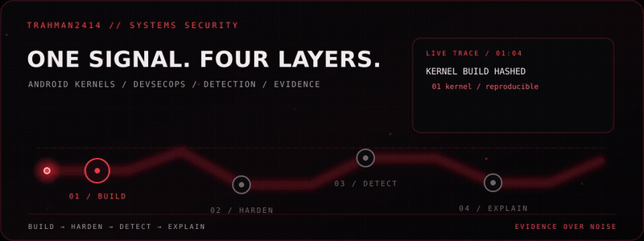
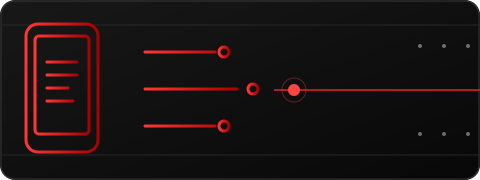
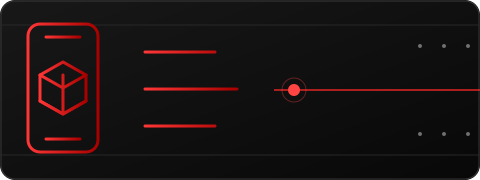
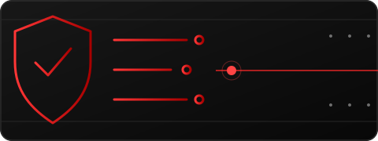
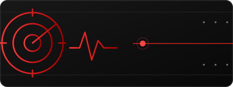
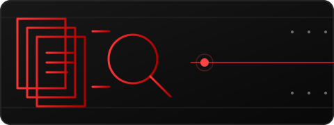
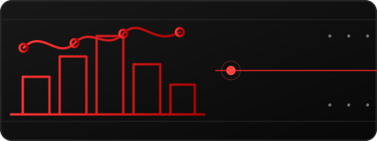
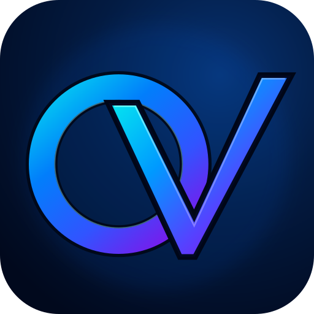
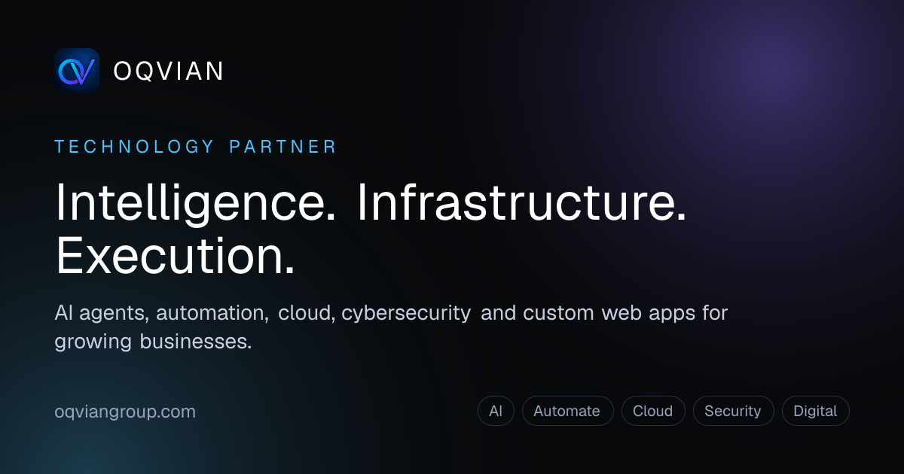
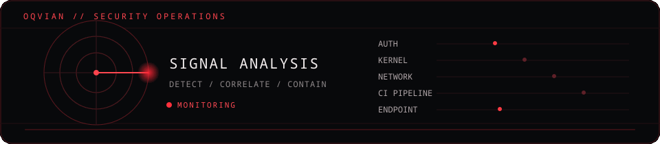

   
  ▶ Open the full 6-second MP4

  <strong>One thread across different layers.</strong> 
  Android/Linux systems · security automation · detection engineering

  <a href="#selected-builds"><code>01 / BUILD</code></a> &nbsp;→&nbsp;
  <a href="https://github.com/TRahman2414/Devsecops-Security-Gate"><code>02 / HARDEN</code></a> &nbsp;→&nbsp;
  <a href="https://github.com/TRahman2414/day-02-detection-engineering"><code>03 / DETECT</code></a> &nbsp;→&nbsp;
  <a href="https://github.com/Ahnaf-Code55/oqvian-recall-remedy-review-release"><code>04 / EXPLAIN</code></a> &nbsp;→&nbsp;
  <a href="#oqvian-group-cloud-security"><code>05 / OQVIAN</code></a>

I build and harden systems from Android kernels and CI security checks to detection rules and evidence-aware applications. I keep the work inspectable and make clear what has—and has not—been verified.

## Selected builds

The red thread runs through all six projects. Each card opens the project; team work is labeled so my role stays clear.

<table>
  <tr>
    <td width="50%" valign="top">
      
      <h3><a href="https://github.com/TRahman2414/helios-kernel">01 · Helios Kernel</a></h3>
      
Custom Android GKI kernel work for Xiaomi Redmi Note 12 4G, including stability patches and AnyKernel3 packaging. Check the project notes for build and device-validation status.

      ANDROID · GKI · XIAOMI
    </td>
    <td width="50%" valign="top">
      
      <h3><a href="https://github.com/TRahman2414/larry-kernel">02 · Larry Kernel</a></h3>
      
Custom GKI 5.4 build and packaging workflow for OnePlus Nord CE 3 Lite. The repository records a successful build; device-function validation is still pending.

      ANDROID · GKI · ONEPLUS
    </td>
  </tr>
  <tr>
    <td width="50%" valign="top">
      
      <h3><a href="https://github.com/TRahman2414/Devsecops-Security-Gate">03 · DevSecOps Security Gate</a></h3>
      
FastAPI demo with CI checks for tests, secret scanning, CodeQL, Trivy, and CycloneDX SBOM generation. Workflow and artifact evidence are linked in the repository.

      PYTHON · CI/CD · SECURITY
    </td>
    <td width="50%" valign="top">
      
      <h3><a href="https://github.com/TRahman2414/day-02-detection-engineering">04 · Detection-as-Code</a></h3>
      
Sigma rules, MITRE ATT&amp;CK mapping, validation, and Splunk/Elasticsearch query conversion. Experimental portfolio work; no live SIEM testing is claimed.

      SIGMA · MITRE ATT&amp;CK · SIEM
    </td>
  </tr>
  <tr>
    <td width="50%" valign="top">
      
      <h3><a href="https://github.com/Ahnaf-Code55/oqvian-recall-remedy-review-release">05 · OQVIAN Recall Remedy Review</a></h3>
      
<b>Team project.</b> My contribution focused on security and operations, including LinuxONE deployment evidence and authenticated-encrypted receipt work. The app helps a human reviewer inspect cited passages and unresolved facts; it does not decide product safety.

      TEAM · SECURITY · EVIDENCE
    </td>
    <td width="50%" valign="top">
      
      <h3><a href="https://github.com/Ahnaf-Code55/firsthour-malaysia">06 · FirstHour Malaysia</a></h3>
      
<b>Team project.</b> My area was backend hardening and security/privacy review for an English/Bangla post-scam response tool. AI extracts evidence-grounded facts; fixed, dated sources drive the action plan.

      TEAM · INCIDENT RESPONSE · PRIVACY
    </td>
  </tr>
</table>

## OQVIAN Group · Cloud & Security

   
   
  <strong>Cloud &amp; Security Lead · OQVIAN Group</strong> 
  <a href="https://www.oqviangroup.com/">Company</a> ·
  <a href="https://www.oqviangroup.com/ai">AI</a> ·
  <a href="https://www.oqviangroup.com/automate">Automate</a> ·
  <a href="https://www.oqviangroup.com/cloud">Cloud</a> ·
  <a href="https://www.oqviangroup.com/security">Security</a> ·
  <a href="https://www.oqviangroup.com/digital">Digital</a> ·
  <a href="https://www.oqviangroup.com/work">Work &amp; reference architectures</a> ·
  <a href="https://www.oqviangroup.com/demos">Interactive demos</a>

   
  OQVIAN security concept · detect · correlate · contain

At OQVIAN, I lead **Cloud and Security**. My work focuses on secure infrastructure, delivery automation, application hardening, detection, and incident readiness. OQVIAN brings five disciplines together: **AI, workflow automation, cloud, security, and digital engineering**. Its public work page shares illustrative architecture patterns, and its demos use sample data; neither is presented as a client case study.

## How I work

- Keep evidence close to the claim.
- Separate a successful build from real-device validation.
- Treat a converted detection rule as different from a live SIEM deployment.
- Make privacy boundaries and known limits visible.

Same thread. Different layers. Real impact starts with evidence.

