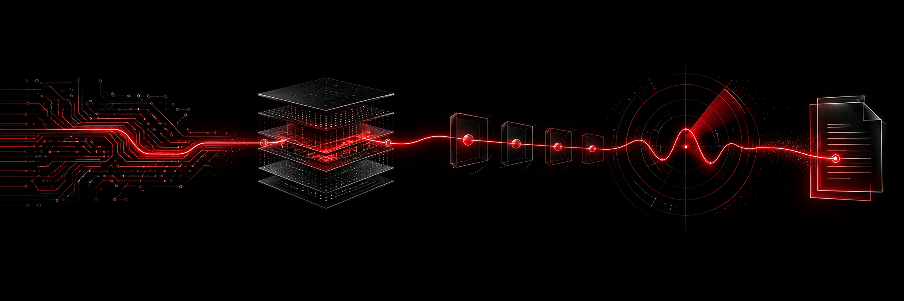

  

<h1 align="center">Tanjidur Rahman</h1>

  <strong>Systems work, with proof for the boundaries.</strong> 
  Android/Linux systems · security automation · detection engineering

<code>BUILD</code> ━━━ <code>HARDEN</code> ━━━ <code>DETECT</code> ━━━ <code>EXPLAIN</code>

I build and harden systems across layers: from Android kernels and security checks in CI to detection rules and evidence-aware applications. I try to make the work inspectable, and to state what has and has not been verified.

## Selected builds

Each project appears at the same level here. Team projects are marked so my role stays clear.

- **[Helios Kernel](https://github.com/TRahman2414/helios-kernel)** · Custom Android GKI kernel work for Xiaomi Redmi Note 12 4G, including stability patches and AnyKernel3 packaging. Check the project notes for build and device-validation status.
- **[Larry Kernel](https://github.com/TRahman2414/larry-kernel)** · Custom GKI 5.4 build and packaging workflow for OnePlus Nord CE 3 Lite. The repository records a successful build; the device-function checklist still needs validation.
- **[DevSecOps Security Gate](https://github.com/TRahman2414/Devsecops-Security-Gate)** · FastAPI demo with CI checks for tests, secret scanning, CodeQL, Trivy, and CycloneDX SBOM generation. The README links the workflow and artifact evidence.
- **[Detection-as-Code](https://github.com/TRahman2414/day-02-detection-engineering)** · Sigma rules, MITRE ATT&CK mapping, validation, and Splunk/Elasticsearch query conversion. Experimental portfolio work; no live SIEM testing is claimed.
- **[OQVIAN Recall Remedy Review](https://github.com/Ahnaf-Code55/oqvian-recall-remedy-review-release)** · **Team project.** My contribution focused on security and operations, including LinuxONE deployment evidence and authenticated-encrypted receipt work. The app helps a human reviewer inspect cited recall passages and unresolved facts; it does not decide product safety or eligibility.
- **[FirstHour Malaysia](https://github.com/Ahnaf-Code55/firsthour-malaysia)** · **Team project.** My area was backend hardening and security/privacy review for an English/Bangla post-scam response tool. Its AI extracts evidence-grounded facts; fixed, dated sources drive the action plan.

## How I work

- Keep evidence close to the claim.
- Separate a successful build from real-device validation.
- Treat a converted detection rule as different from a live SIEM deployment.
- Make privacy boundaries and known limits visible.

## Areas I work in

`Linux` · `Android GKI` · `Python` · `Bash` · `GitHub Actions` · `DevSecOps` · `Sigma` · `MITRE ATT&CK` · `LinuxONE`

---

One thread across different layers: build carefully, harden deliberately, verify what matters, explain the limits.
