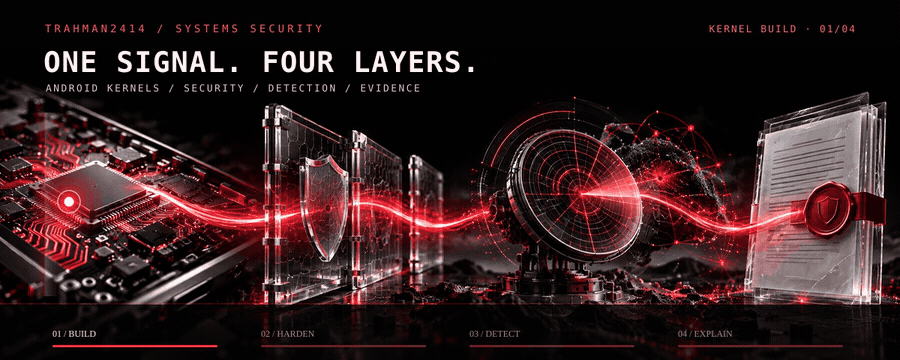
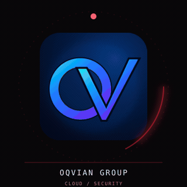
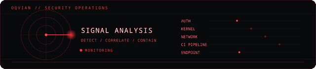
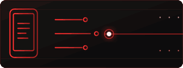
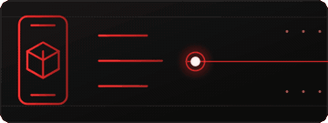
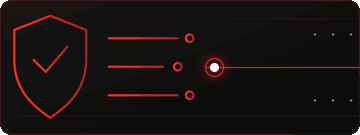
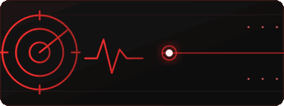
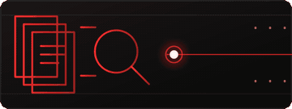
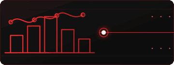

   
  ▶ Play the full 8-second cinematic reel

  <strong>I follow systems from the kernel outward.</strong> 
  Android/Linux → secure delivery → detection → evidence

  <a href="#oqvian-group-cloud-security"><code>01 / COMPANY</code></a> &nbsp;→&nbsp;
  <a href="#selected-work"><code>02 / SELECTED WORK</code></a> &nbsp;→&nbsp;
  <a href="#field-standard"><code>03 / FIELD STANDARD</code></a>

## OQVIAN Group · Cloud & Security

<table>
  <tr>
    <td width="28%" align="center" valign="middle">
       
      <strong>Cloud &amp; Security Lead</strong> 
      OQVIAN GROUP
    </td>
    <td width="72%" valign="middle">
      
    </td>
  </tr>
  <tr>
    <td colspan="2" align="center">
      <a href="https://www.oqviangroup.com/ai"><code>AI</code></a> &nbsp;·&nbsp;
      <a href="https://www.oqviangroup.com/automate"><code>AUTOMATION</code></a> &nbsp;·&nbsp;
      <a href="https://www.oqviangroup.com/cloud"><code>CLOUD</code></a> &nbsp;·&nbsp;
      <a href="https://www.oqviangroup.com/security"><code>SECURITY</code></a> &nbsp;·&nbsp;
      <a href="https://www.oqviangroup.com/digital"><code>DIGITAL</code></a>
    </td>
  </tr>
</table>

At OQVIAN, I lead Cloud &amp; Security across secure infrastructure, application hardening, delivery automation, detection, and incident readiness. The company connects AI, workflow automation, cloud, security, and digital engineering. Its public work pages show illustrative architectures, and its demos use sample data.

   
  OQVIAN security lens · identify → correlate → contain

## Selected work

One thread runs through six builds: device kernels, secure delivery, detection rules, and evidence-led tools. The two Android kernel projects stay in this same lineup.

<table>
  <tr>
    <td width="50%" valign="top">
      
      <h3><a href="https://github.com/TRahman2414/helios-kernel">01 · Helios Kernel</a></h3>
      
Android GKI work for Xiaomi Redmi Note 12 4G, including stability patches and AnyKernel3 packaging. The project notes distinguish build and packaging from device validation.

      ANDROID · GKI · XIAOMI
    </td>
    <td width="50%" valign="top">
      
      <h3><a href="https://github.com/TRahman2414/larry-kernel">02 · Larry Kernel</a></h3>
      
GKI 5.4 build and packaging workflow for OnePlus Nord CE 3 Lite. A successful build is recorded; device-function validation remains open.

      ANDROID · GKI · ONEPLUS
    </td>
  </tr>
  <tr>
    <td width="50%" valign="top">
      
      <h3><a href="https://github.com/TRahman2414/Devsecops-Security-Gate">03 · DevSecOps Security Gate</a></h3>
      
FastAPI demo with tests, secret scanning, CodeQL, Trivy, and CycloneDX SBOM generation. Workflow runs and artifacts make the checks inspectable.

      PYTHON · CI/CD · SECURITY
    </td>
    <td width="50%" valign="top">
      
      <h3><a href="https://github.com/TRahman2414/day-02-detection-engineering">04 · Detection-as-Code</a></h3>
      
Sigma rules, MITRE ATT&amp;CK mapping, automated validation, and Splunk/Elasticsearch query conversion. This is portfolio work, not a claim of live SIEM deployment.

      SIGMA · MITRE ATT&amp;CK · SIEM
    </td>
  </tr>
  <tr>
    <td width="50%" valign="top">
      
      <h3><a href="https://github.com/Ahnaf-Code55/oqvian-recall-remedy-review-release">05 · OQVIAN Recall Remedy Review</a></h3>
      
<b>Team project.</b> My scope covered security and operations, including LinuxONE deployment evidence and encrypted receipt work. The tool helps a human inspect cited passages; it does not decide product safety.

      TEAM · SECURITY · EVIDENCE
    </td>
    <td width="50%" valign="top">
      
      <h3><a href="https://github.com/Ahnaf-Code55/firsthour-malaysia">06 · FirstHour Malaysia</a></h3>
      
<b>Team project.</b> My work focused on backend hardening and security/privacy review for an English/Bangla post-scam tool. AI extracts sourced facts; dated sources guide next steps.

      TEAM · INCIDENT RESPONSE · PRIVACY
    </td>
  </tr>
</table>

## Field standard

I keep three things separate: a successful build and device validation; a mapped detection and a live SIEM; my contribution and the team’s work.

Build with intent. Follow the signal. Leave evidence behind.

